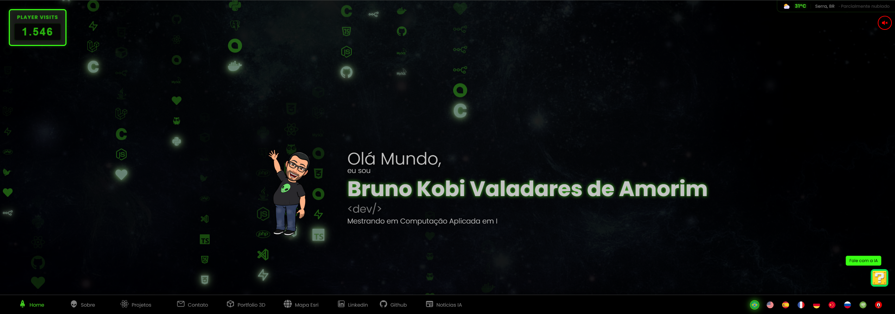

# 🛸 Bruno Kobi — Full Stack Developer & AI Systems Engineer

> **"Não é um portfólio. É um ecossistema digital inteligente em produção."**



<p align="center">
  
  
  
  
  
</p>

<p align="center">
  
  
  
  
  
  
  
  
  
  
  
  
  
  
</p>

<p align="center">
  <a href="https://brunokobi.tech" target="_blank"><strong>🌐 Ver ao vivo</strong></a> ·
  <a href="https://www.linkedin.com/in/brunokobi/" target="_blank">LinkedIn</a> ·
  <a href="https://github.com/brunokobi" target="_blank">GitHub</a>
</p>
<p align="center">
  <sub>(também disponível em <a href="https://brunokobi.netlify.app">brunokobi.netlify.app</a>)</sub>
</p>

<p align="center">
  <a href="https://github.com/sponsors/brunokobi">
    
  </a>
</p>

---

## 🌌 O que é este projeto?

A maioria dos portfólios é uma página estática com foto e lista de habilidades. Este é diferente.

Este portfólio foi construído como uma **plataforma de software completa**, integrando tecnologias de produção reais: banco de dados com Row Level Security, automação event-driven com IA, assistente virtual **JARVIS** com voz (n8n, voz neural Piper e transcrição Whisper, tudo self-hosted numa VPS própria na Oracle Cloud, atrás de Cloudflare), globo 3D interativo com **overlays geoespaciais em tempo real** (satélites, ISS, cidades com clima & hora local, qualidade do ar, incêndios, alertas, terremotos, vulcões, furacões), feed de notícias em tempo real de **52 fontes globais** com scoring inteligente, tradução automática, geolocalização GPS, internacionalização em 9 idiomas, selo de status ao vivo da infra em produção e acessibilidade com síntese de voz.

Cada feature foi pensada para demonstrar **profundidade técnica real** — não apenas que sei usar uma tecnologia, mas que sei arquitetá-la, integrá-la e colocá-la em produção.

---

## 🏗️ Arquitetura Geral

```
┌─────────────────────────────────────────────────────────┐
│              Browser (React 18 + Vite 5)                │
│  i18n · WeatherBar · ArcGIS · TextToSpeech · JARVIS     │
│  ServiceStatus (ping ao vivo da infra própria)          │
└──────────────────┬──────────────────────────────────────┘
                   │ HTTPS
      ┌────────────┼──────────────────┬──────────────────────┐
      │            │                  │                      │
      ▼            ▼                  ▼                      ▼
Netlify Fn     Supabase (BaaS)    Netlify Fn: n8n-chat.ts   Áudio direto do navegador
TypeScript     PostgreSQL + RLS   (proxy, esconde a URL)    (CORS só para o site)
- Proxy RSS    JWT Auth                 │                      │
- Contato      Shared Client            │                      │
  → Resend     - infra-stats            ▼                      ▼
                          Cloudflare (proxy) → Traefik (Coolify)
                                         │
                          Oracle Cloud VPS (ARM64, self-hosted)
                          ┌──────────────────────────────────────┐
                          │ n8n: JARVIS (agente único + perfil)   │
                          │ Piper TTS   tts.brunokobi.tech        │
                          │ Whisper     whisper.brunokobi.tech    │
                          │ API do Dataset Grande Vitória         │
                          └──────────────────────────────────────┘

Open-Meteo API (clima)
ipapi.co (geolocalização)
Google Translate API (tradução automática)
Resend API (email transacional)
```

**Princípios adotados:** Clean Architecture · Event-Driven · Serverless First · BaaS · Modularização por domínio

---

## 🛠️ Stack Completa

| Camada          | Tecnologia                   | Uso                                                |
| --------------- | ---------------------------- | -------------------------------------------------- |
| Frontend        | React 18 + Hooks             | SPA com Context API                                |
| Build           | Vite 5                       | Dev server HMR instantâneo, bundle otimizado       |
| UI              | Chakra UI v2                 | Design system responsivo                           |
| Animação        | Framer Motion v11            | Transições e stagger animations                    |
| i18n            | React-Intl                   | 9 idiomas + auto-detect por IP                     |
| Voz             | Piper (VPS) + Web Speech API | Voz neural; voz do navegador como alternativa      |
| Qualidade       | TypeScript strict + ESLint 9 | Zero erros, regras de pureza React, Prettier       |
| Testes          | Vitest + Playwright          | 174 testes unitários + E2E Chromium                |
| Backend         | Supabase                     | PostgreSQL + Auth + RLS + Edge Functions           |
| Automação       | n8n (self-hosted, Oracle Cloud VPS) | Workflows event-driven + agente JARVIS             |
| IA — Chat       | Nemotron 3 Ultra (OpenRouter, via n8n) | JARVIS, com o perfil gerado no build como única fonte |
| IA — Contato    | Google Gemini 2.5 Flash Lite | Análise das mensagens do formulário de contato     |
| Voz (fala)      | Piper TTS (VPS)              | Voz neural em 7 idiomas, cache na Cloudflare       |
| Voz (ouvido)    | Whisper (VPS)                | Transcrição das perguntas faladas ao JARVIS        |
| Email           | Resend                       | Transacional                                       |
| Infra           | Oracle Cloud VPS + Cloudflare + Traefik | n8n, Piper, Whisper e API do dataset self-hosted |
| Deploy          | Netlify                      | CI/CD + Serverless Functions                       |
| GIS             | ESRI ArcGIS                  | Mapas 3D interativos                               |
| Clima           | Open-Meteo                   | API gratuita, sem chave                            |
| Geoloc.         | ipapi.co                     | IP → país/cidade/coords                            |

---

## 🚀 Rodando localmente

### Pré-requisitos

- Node.js 18+
- npm 9+
- Conta no [Supabase](https://supabase.com)
- Conta no [Netlify](https://netlify.com) (para as functions)
- Chave de API do [ESRI ArcGIS](https://developers.arcgis.com)

### Instalação

```bash
git clone https://github.com/brunokobi/projeto-portifolio.git
cd projeto-portifolio
npm install
```

### Variáveis de ambiente

Crie um arquivo `.env.local` na raiz (veja `.env.example` para referência completa):

```env
VITE_SUPABASE_URL=https://xxxx.supabase.co
VITE_SUPABASE_ANON_KEY=eyJhbGciOiJIUzI1NiIs...
VITE_ESRI_API_KEY=AAPTxy8BH...
RESEND_API_KEY=re_xxxx          # Netlify env var — envio de email do formulário de contato
CONTACT_TO_EMAIL=seu@email.com  # Netlify env var — destino das notificações (opcional)
TELEGRAM_BOT_TOKEN=123456:ABC   # Netlify env var — bot de alertas em tempo real
TELEGRAM_CHAT_ID=-100xxxx       # Netlify env var — chat/grupo que recebe os alertas

# OpenTelemetry (opcional — se não configurado, tracing é desativado silenciosamente)
OTEL_EXPORTER_OTLP_ENDPOINT=https://otlp-gateway-prod-eu-west-0.grafana.net/otlp
OTEL_EXPORTER_OTLP_HEADERS=Authorization=Basic xxxx  # token do Grafana Cloud / Honeycomb
```

### Comandos

```bash
npm start          # Desenvolvimento (Vite dev server, porta 3000)
npm run build      # Build de produção (saída em /dist)
npm run preview    # Pré-visualizar build de produção localmente
npm test           # Testes em modo watch
npm run test:run   # Testes CI (execução única)
npm run coverage   # Cobertura de testes (relatório HTML)
npx playwright test  # Testes E2E (requer Playwright instalado)
```

> Para testar as Netlify Functions localmente, use `netlify dev` no lugar de `npm start`.

---

## 🌍 Feature: Globo 3D Interativo com Modo Dia/Noite

> **Complexidade:** ⭐⭐⭐⭐ — ArcGIS SceneView 3D + NASA GIBS WMTS + BaseTileLayer customizado + geolocalização + arcos de voo animados

Globo 3D em tempo real renderizado com **ArcGIS SceneView** com iluminação virtual uniforme (cobre o globo inteiro), sistema de dia/noite alternável e visualização de luzes da Terra à noite via **NASA Black Marble**.

### Modo Dia
- Basemap de satélite de alta resolução (`World_Imagery` — ESRI)
- Iluminação virtual uniforme: o globo inteiro exibe o mapa de dia
- Rotação automática com pausa ao interagir

### Modo Noite (`☾ NOITE` na barra de clima)
- Troca para **NASA Black Marble 2016** (`VIIRS_Black_Marble` via NASA GIBS WMTS)
- Tiles coloridos em tempo real via `BaseTileLayer` com processamento canvas pixel a pixel:
  - Preto → preto (oceano sem luz)
  - Baixo brilho → âmbar (subúrbios)
  - Alto brilho → dourado (centros urbanos)
  - Núcleo → branco-dourado (metrópoles)
- Escurecimento do globo para realismo noturno (`brightness(0.6)`)
- Preferência salva em `localStorage`

### Outros recursos do globo
- **Pin de geolocalização** amarelo pulsante com nome da cidade do visitante (browser Geolocation API + Nominatim reverse geocoding)
- **26 pins** de cidades globais com animação de pulso verde
- **Arcos de voo** animados ao clicar num pin: trajetória esférica (`SLERP`) até Vitória-ES
- **Clique no mapa**: exibe coordenadas lat/lon em popup

---

## 🤖 Feature: JARVIS — Assistente Virtual com Voz

> **Complexidade:** ⭐⭐⭐⭐⭐ — agente n8n com perfil gerado no build + voz neural Piper + transcrição Whisper, tudo self-hosted em VPS própria

Assistente que responde sobre o Bruno por texto e por voz: o visitante fala, o **Whisper** transcreve, o agente do **n8n** responde e o **Piper** lê a resposta em voz alta. Os três rodam na VPS da Oracle Cloud, atrás da Cloudflare.

### Por que um agente só, com o perfil no prompt?

A versão anterior tinha um roteador, 7 agentes especializados e busca vetorial no Supabase pgvector. Ela inventava experiência: os agentes não tinham fatos no prompt e nem sempre chamavam a busca. Hoje o build gera `/jarvis/perfil.md` a partir dos mesmos textos do site (currículo, projetos e skills do `pt.json`), e um único agente recebe esse perfil inteiro como **única fonte**. Mudou o currículo no site, o JARVIS já sabe no próximo deploy.

### Fluxo completo

```
Visitante fala
  → useWhisperRecorder grava no navegador e para após 1,5s de silêncio
  → POST https://whisper.brunokobi.tech/inference (Whisper na VPS)
  → texto transcrito vai como pergunta
  → POST /.netlify/functions/n8n-chat { chatInput, sessionId } (proxy, esconde a URL do n8n)
  → n8n: Chat Trigger → baixa /jarvis/perfil.md → agente JARVIS (memória de 10 mensagens)
  → resposta curta, escrita para ser ouvida
  → GET https://tts.brunokobi.tech/tts.mp3 (Piper na VPS), trecho a trecho
  → voz do navegador como alternativa se o Piper falhar
```

### Como o JARVIS fala

- Persona do J.A.R.V.I.S.: calmo, educado, humor seco e discreto
- Até ~60 palavras em texto corrido, sem listas nem links, a não ser que o visitante peça
- Fala do Bruno em terceira pessoa e diz que não sabe quando a informação não está no perfil, sem inventar
- Entende erros de transcrição pelo contexto ("Venix" é Vennx, "Cobi" é Kobi)

### Infraestrutura

- **Oracle Cloud VPS (ARM64)**, com Traefik (Coolify) atrás do proxy da Cloudflare
- **Piper TTS:** FastAPI + `piper-tts`, vozes masculinas em pt, en, es, fr, de, ru e ar, uma síntese por vez, limite de 1 CPU, 30 sínteses por minuto por IP e cache de 30 dias na Cloudflare
- **Whisper:** whisper.cpp atrás de um gateway FastAPI, com CORS liberado só para o site

---

## 💬 Feature: Chat IA — JARVIS

Widget de chat (`ChatWidget`) em que o assistente se apresenta como **JARVIS**, com resposta via agente n8n (chatBruno), voz (TTS) e uma interface visual em canvas.

- **Saudação dinâmica:** ao abrir o widget, `src/utils/generateGreeting.ts` usa a geolocalização do navegador, o clima (Open-Meteo) e a cidade (Nominatim) para saudar com "Bom dia/Boa tarde/Boa noite", cidade, temperatura e condição ("Em Serra agora faz 27°C, com chuva"); sem geolocalização, usa uma apresentação fixa. É falada se o áudio estiver ativo e o navegador permitir
- **Voz:** voz neural **Piper** servida pela VPS em `tts.brunokobi.tech` (pt, en, es, fr, de, ru e ar), com a voz do navegador (Web Speech API) para o chinês e como alternativa se o Piper falhar (`src/utils/piperTts.ts` e `src/utils/textToSpeech.ts`); a fala do chat usa velocidade 1.4 (`src/hooks/useChatWithAudio.ts`)
- **JARVIS Core:** núcleo animado em canvas no cabeçalho do chat (`src/components/ChatWidget/JarvisCore.tsx`), com quatro estados mostrados também em texto: Online, Pensando..., Falando... e Ouvindo...; com a voz do Piper as barras seguem o espectro real da fala (`AnalyserNode`); com a voz do navegador o espectro é animado
- **Sugestões de perguntas:** botões prontos (Quem é o Bruno?, Projetos, Tecnologias, Experiência, Contato) até o visitante fazer a primeira pergunta
- **Indicador de digitando:** três pontos animados enquanto o agente responde
- **Respostas formatadas:** negrito, listas e links clicáveis, sem os asteriscos do markdown (`formatMessage.tsx`, sem injetar HTML)
- **Perguntar por voz:** o botão de microfone grava no navegador e transcreve no Whisper self-hosted (`whisper.brunokobi.tech`, `src/hooks/useWhisperRecorder.ts`); para sozinho depois de 1,5s de silêncio e envia a pergunta. Um prompt com o vocabulário do site (JARVIS, Kobi, Vennx, React, n8n) ajuda o Whisper a acertar os nomes. Navegador que não grava áudio usa o reconhecimento de voz do próprio navegador (`src/hooks/useSpeechRecognition.ts`)
- **Layout:** o chat ocupa a altura do painel lateral, sem rolagem da página; só a lista de mensagens rola
- **Backend:** workflow n8n via `netlify/functions/n8n-chat.ts` (ver a seção acima e [docs/FEATURES.md](docs/FEATURES.md#-chat-ia-n8n))

---

## 📰 Feature: Painel de Notícias de IA em Tempo Real

> **Complexidade:** ⭐⭐⭐⭐⭐ — CORS proxy serverless + RSS multi-formato + scoring tiered + hero carousel + tradução automática com prioridade + anti-spam

Um painel completo que agrega **52 feeds RSS** de fontes globais de IA (incluindo OpenAI, Anthropic, DeepMind, NVIDIA), com sistema de pontuação por relevância, filtro de artigos anteriores a 2025, tradução automática para português e carrossel principal com seleção das melhores notícias do momento.

### Fluxo completo

```
Browser
  → /.netlify/functions/news?url=<encoded_feed_url>
  → Netlify Function busca XML com User-Agent e timeout 8s
  → Retorna XML com headers CORS + Cache-Control 5min
Browser
  → parseRSS() — extrai título, link, data, imagem (RSS 2.0 / Atom / Media RSS)
  → cleanDesc() — remove boilerplate legal com regex patterns
  → Pré-score heroScore() — identifica candidatos ao carrossel antes da tradução
  → translateArticles(raw, heroLinkSet)
      · Candidatos do hero entram no 1º lote (título + desc traduzidos)
      · Demais artigos não-BR: até 80 por ciclo (batches de 5)
      · sl=auto — detecta inglês, chinês, japonês etc.
  → scoreArticle() — pontua todos os artigos
  → isTooOld() — rejeita artigos anteriores a 2025-01-01
  → isSpam() — filtra promoções e eletrônicos de consumo
  → isRelevant() — fontes mistas exigem keyword de IA/dev
  → heroSlides: artigos < 7 dias, ordenados por heroScore()
  → sorted: todos filtrados, por importância ou data (escolha do usuário)
  → Cache in-memory por 5 minutos
```

### Sistema de scoring do carrossel (heroScore)

O hero carousel usa um scoring independente, focado em **recência + impacto**, com bônus tiered por fonte e keywords com cap para evitar inflação artificial:

```typescript
// Bônus por fonte — labs primários lideram
const HERO_SOURCE_BONUS = {
  Anthropic: 32, OpenAI: 32,       // primários
  DeepMind: 28,  "Google Res.": 24, "NVIDIA Blog": 22,  // grandes players
  "MIT Tech Rev": 18, HuggingFace: 16, TechCrunch: 13,  // jornalismo especializado
};

function heroScore(article) {
  let s = HERO_SOURCE_BONUS[source] ?? SOURCE_PRESTIGE[source] ?? 3;

  // Keywords de lançamento (cap 2 = máx +44)
  // "launch", "release", "gpt-5", "claude 4", "gemini 2"...
  s += launchKeywords (até 2 matches × +22);

  // Spotlight empresa/modelo (cap 2 = máx +28)
  // "openai", "anthropic", "deepseek", "grok", "nvidia"...
  s += spotlightKeywords (até 2 matches × +14);

  // Recência dominante — breaking news sempre vence
  const h = horasDesdePublicação;
  s += h < 2 ? 55 : h < 6 ? 44 : h < 12 ? 33 : h < 24 ? 20 : h < 48 ? 8 : 0;

  if (article.desc?.length > 40) s += 4; // qualidade visual no slide
  return s;
}

// Exemplo: OpenAI anuncia GPT-5, publicado há 1h
// 32 (base) + 22 (launch) + 22 (gpt-5) + 14 (openai) + 14 (gpt) + 55 (< 2h) + 4 = 163 pts
```

### Filtro de relevância por fonte

Fontes mistas (Tecnoblog, NeoFeed, SCMP, ETH Zurich etc.) só exibem artigos que contenham ao menos uma keyword de IA/dev: `inteligência artificial`, `machine learning`, `llm`, `openai`, `kubernetes`, `cibersegurança`...

### Netlify Function (proxy RSS)

```typescript
export const handler: Handler = async (event) => {
  const feedUrl = event.queryStringParameters?.url;
  const res = await fetch(feedUrl, {
    headers: { "User-Agent": "Mozilla/5.0", Accept: "application/rss+xml, */*" },
    signal: AbortSignal.timeout(8000),
  });
  return {
    statusCode: 200,
    headers: {
      "Content-Type": "application/xml",
      "Access-Control-Allow-Origin": "*",
      "Cache-Control": "public, max-age=300",
    },
    body: await res.text(),
  };
};
```

### Fontes ativas (52)

**Brasil 🇧🇷** — SWEN.AI · AINEWS · Exame IA · NeoFeed · Tecnoblog · Olhar Digital · TabNews · Manual Usuário · MIT Tech BR · Brazil Journal

**Labs primários 🌎** — OpenAI · Anthropic · DeepMind · Google Research · NVIDIA Blog

**Pesquisa 🔬** — MIT News · MIT Tech Rev · BAIR · The Gradient · IEEE Spectrum · IEEE TV AI · arXiv cs.AI · Apple ML · Stanford AI · ScienceDaily · ETH Zurich · TUM

**Indústria 🌎** — The Verge · TechCrunch · Wired AI · AI News · AI Insider · AI Weekly · MarkTechPost · AWS ML · Reuters Inst. Oxford

**Modelos & Tools** — HuggingFace · KDnuggets · fast.ai · TensorFlow · Towards AI · LangChain

**Ásia & China 🌏** — AI Singapore · RIKEN AIP · Synced · ChinAI Newsletter · SCMP Tech

**Engenharia 💻** — Pragmatic Eng. · Martin Fowler · Netflix Tech · n8n Blog · Supabase

---

## ⚡ Feature: Formulário de Contato com Email Transacional

> **Complexidade:** ⭐⭐⭐⭐ — Two-step submit: Supabase INSERT (audit) + Netlify Function → Resend API

Quando um visitante envia o formulário, o fluxo ocorre em dois passos independentes: primeiro persiste no banco (audit trail garantido), depois a Netlify Function chama a **Resend API** diretamente para enviar a notificação.

```
Formulário (React)
  → Passo 1: Supabase INSERT (tabela contatos, RLS ativo) — audit trail
  → Passo 2: POST /.netlify/functions/chat
      → Netlify Function (TypeScript)
          → Resend API — envia notificação HTML para o dono do portfólio
  → Feedback ao usuário:
      · Banco OK + email OK  → toast "SINAL RECEBIDO" (verde)
      · Banco OK + email fail → toast "SINAL PARCIAL" (aviso)
      · Banco fail            → toast "FALHA NA TRANSMISSÃO" (erro)
```

### Por que two-step e não tudo na function?

| Abordagem              | Vantagem                                                    |
| ---------------------- | ----------------------------------------------------------- |
| Só Netlify Function    | Mensagem perdida se function falhar                         |
| **Two-step** ✅         | Dado sempre persistido; email é melhor esforço com feedback |

---

## 🌐 Feature: Globo 3D Interativo — Background da Home

> **Complexidade:** ⭐⭐⭐⭐⭐ — ESRI SceneView 3D + Canvas overlay + slerp + geolocalização + câmera dinâmica

O globo 3D que serve como plano de fundo da Home é muito mais do que uma animação decorativa — é um sistema geoespacial interativo completo construído sobre a **ESRI ArcGIS Maps SDK**.

### Configuração visual

- Satélite imagery (`World_Imagery`) como basemap diurno
- **NASA Black Marble** via MapTiler (`earth-at-night`) como basemap noturno — luzes das cidades reais à noite em cores reais
- Elevação exagerada: montanhas ×40, batimetria ×60 — relevo visível do espaço
- Camada de nuvens com textura NASA real (`clouds-nasa.png`)
- Esfera oceânica metálica azul como fundo dos oceanos
- Atmosfera realista `quality: "high"` — glow azul nas bordas do planeta
- Estrelas (`starsEnabled: true`) — fundo espacial ao redor do globo
- Iluminação solar baseada na data/hora atual — posição real do sol no céu
- Zoom de 4 Mm a 25 Mm de altitude (scroll do mouse)

### Animação de Entrada

Ao carregar a página, a câmera parte de **65 Mm de altitude** (visão galáctica completa do planeta) e faz um zoom dramático até a posição padrão (~20 Mm) com easing `out-expo` em 4 segundos — dando a sensação de "pousar" na Terra vindo do espaço. A rotação automática só inicia após o zoom completar.

### 26 Pins de Cidades Globais

26 cidades distribuídas para garantir sempre ao menos 2–3 pins visíveis independente da rotação do globo:

| Continente | Cidades |
|---|---|
| América do Sul | São Paulo, Vitória-ES, Buenos Aires |
| América do Norte | Mexico City, Chicago, New York, San Francisco |
| Europa | Madrid, London, Paris, Berlin, Moscow |
| Oriente Médio / África | Istanbul, Nairobi, Cairo, Lagos, Dubai |
| Ásia | Mumbai, Bangkok, Singapore, Beijing, Seoul, Tokyo |
| Oceania / Pacífico | Sydney, Auckland, Honolulu |

**Visibilidade inteligente** via produto escalar câmera × cidade — pins aparecem apenas no lado visível do globo, sem atravessar a esfera. **Canvas overlay** animado via `requestAnimationFrame`: anel verde Matrix pulsante + glow nos pins. **Cursor pointer** ao passar o mouse sobre qualquer pin (detectado via `pointer-move` do ESRI).

### Pin do Visitante (Geolocalização)

Ao aceitar a permissão de localização, um **pin amarelo pulsante** aparece na posição real do visitante. O nome da cidade é obtido via **Nominatim (OpenStreetMap)** — gratuito, sem API key.

### Arcos de Voo Animados

Clique em qualquer pin verde → arco **laranja animado** traçando a rota até Vitória-ES pelo grande círculo terrestre:

```
Clique no pin
  → slerp(fromCity, Vitória-ES, t) — interpolação esférica em 81 pontos
  → altitude parabólica (pico de 1.200 km acima da superfície)
  → canvas desenha o arco frame a frame (2,8 s de traçado)
  → ponto laranja na ponta simula o "avião"
  → label "✈ Tokyo → Vitória-ES" no meio do arco
  → arco some após ~5,5 s (desenho + hold + fade)
```

### Câmera Dinâmica

| Fase | Comportamento |
|---|---|
| Rotação normal | Auto-rotação contínua (−0,15°/frame) |
| Arco `drawing` | Câmera segue a ponta do arco com lerp suave |
| Arco `holding` | Câmera estabiliza sobre Vitória-ES |
| Arco `fading` | Auto-rotação retoma automaticamente |
| Drag do usuário | Pausa a rotação por 3 s, depois retoma |

### Controles

- **Clique no globo** → popup com coordenadas lat/lon do ponto clicado
- **Botão ☾ NOITE / ☀ DIA** (no WeatherBar) — alterna para NASA Black Marble (MapTiler) + rotaciona o sol 12 h para o terminador real

---

## 🌍 Feature: Globo 3D com Overlays Geoespaciais em Tempo Real

> **Complexidade:** ⭐⭐⭐⭐⭐ — Canvas overlay + coordinate transformation (lat/lon → screen) + 2h weather cache + real-time API polling + toggle UI + localStorage persistence

Sistema completo de visualização de dados geoespaciais em tempo real sobre o globo 3D interativo. As features abaixo aparecem sobre o mapa com hover interativo, informações dinâmicas e controles ON/OFF individuais.

### Features suportadas

| Feature | Ícone | Fonte | Atualização | Hover Info |
|---|---|---|---|---|
| **Satélites** | 🛰️ | CelesTrak (TLE de GPS, Galileo e meteorológicos) + SGP4 (`satellite.js`) | Posição recalculada a cada 10s (TLE em cache por 2h) | Nome e altitude |
| **ISS** | 🛰️ | wheretheiss.at | 8s | Altitude e velocidade |
| **Cidades** | 🏙️ | `CITIES` (`geo.ts`) + Open-Meteo | Clima com cache de 2h | Hora local, temperatura, clima, AQI, país |
| **Qualidade do Ar** | 💨 | OpenAQ PM2.5 via ArcGIS Living Atlas (estação a até 50 km da cidade) | Ao carregar a página | Só no card de hover da cidade |
| **Incêndios** | 🔥 | NASA VIIRS via ArcGIS Living Atlas (últimas 6h, confiança alta) | Ao carregar a página | Local e confiança da detecção |
| **Alertas** | ⚠️ | CAP Alerts Feed via ArcGIS Living Atlas (avisos oficiais) | Ao carregar a página | Evento, severidade, área e órgão emissor |
| **Terremotos** | 🌍 | USGS (M4.5+ das últimas 24h) | Ao carregar a página | Magnitude, local e há quanto tempo |
| **Vulcões** | 🌋 | Smithsonian GVP | Ao carregar a página | Nome, país, tipo e elevação |
| **Furacões** | 🌀 | Active Hurricanes via ArcGIS Living Atlas (NHC + JTWC) | Ao carregar a página | Nome, categoria, velocidade do vento e pressão |
| **Vento** | 💨 | Grade de vento de superfície (modelo GFS, 1°) do repositório público `firestorm-wind-data` | Ao carregar a página (o repositório é atualizado periodicamente) | — |

Aviões (OpenSky) estão desligados porque a API bloqueia chamadas do navegador (CORS).

### Implementação técnica

**Renderização:**
- Canvas overlay 2D sobre o globo 3D
- Coordenadas lat/lon convertidas para screen coordinates via `view.toScreen()`
- Visibilidade inteligente: `isFacing()` filtra pontos no lado visível do globo (sem atravessar a esfera)
- Z coordinate para depth rendering correto em 3D

**Interação:**
- Hover detection com `mousemove` — detecta proximidade de pontos em pixels (10–15px de raio)
- Pontos de cidade (`CITIES`) são anéis verdes pulsantes; o AQI não é desenhado como ponto no mapa, só no card de hover da cidade, buscado na hora do primeiro hover (estação real a até 50 km; sem estação, o card fica sem AQI)
- Clique em pins abre tooltip customizado com dados contextuais

**Tamanho pelo zoom:**
- `iconScale.ts` calcula um fator pela altitude da câmera: tamanho cheio até 8.000 km e metade a partir de 22.000 km. Raios, offsets e fontes de todas as camadas são multiplicados por ele (fonte mínima de 7px). As linhas de vento fazem o contrário e engrossam com a câmera perto (3,5px a 4.000 km, 1,1px a partir de 22.000 km).
- Com o globo afastado, as legendas curtas dos satélites ("Nav", "Weather") somem; o nome continua no hover.

**Performance:**
- Satélites: polling de 10s só recalcula a posição pelo SGP4; o TLE é baixado do CelesTrak no máximo a cada 2h
- Weather cache com 2h TTL — previne overload da Open-Meteo API ao fazer hover repetido
- Lazy loading dos dados — arrays de screen positions resetados apenas quando feature toggled ou dados mudaram
- RequestAnimationFrame — todos os cálculos sincronizados com frame do navegador

### WeatherBar — Controles ON/OFF

Botões toggle individuais para cada feature na barra de clima (superior):
```
🌙 NOITE  💨 VENTO  🛰️ ISS  🌀 FUR  🌍 TERREMOTOS  🌋 VULCÕES  🛰️ SAT  🔥 FOGO  ⚠️ ALERTAS
```

- Na Home, a barra aparece quando o globo termina de carregar (`src/utils/globeReady.ts`); nas outras páginas aparece na hora
- Os botões não dependem do clima: temperatura e cidade entram quando o Open-Meteo responde e ficam ocultas se falhar
- Geolocalização do navegador com timeout de 8s; sem resposta ou negada, cai para `ipapi.co`
- Cada toggle emite CustomEvent capturado pelo GlobeBackground
- Estado salvo em localStorage — preferências persistem entre sessões
- Visual feedback: botão ativo (verde) vs. inativo (cinza)

### Cidades com Clima & Hora Local

Todas as **42 cidades** do globo (`CITIES` em `geo.ts`, marcadas por anéis verdes pulsantes) exibem no card de hover:
- **Hora local** 🕐 — convertida via `Intl.DateTimeFormat` para o timezone da cidade (Open-Meteo, `timezone=auto`)
- **Temperatura** — arredondada em °C
- **Condição do tempo** — emoji WMO (☀️, 🌧️, ⛈️, etc.)
- **AQI** — tag com valor e classificação qualitativa: Bom (≤50), Moderado (≤100), Insalubre (Sensíveis) (≤150), Insalubre (≤200), Muito Insalubre (≤300), Perigoso (>300)

Exemplo de card ao passar o mouse em Londres:
```
Londres 🇬🇧
Principal ecossistema de fintech...

🕐 14:30
☀️ 24°C

Fintech  IA  DeFi  💨 AQI: 45 (Bom)
```

### APIs utilizadas

| Fonte | Endpoint | Limite Free | Uso |
|---|---|---|---|
| Open-Meteo | `api.open-meteo.com/v1/forecast` | Ilimitado | Clima + timezone (2h cache) |
| CelesTrak | `celestrak.org/NORAD/elements/gp.php` | ~1 consulta por grupo a cada 2h | TLEs de GPS, Galileo e meteorológicos (satélites) |
| wheretheiss.at | `api.wheretheiss.at/v1/satellites/25544` | Sem chave | Posição da ISS (8s) |
| ArcGIS Living Atlas | `services9.arcgis.com/.../FeatureServer` | Sem chave | Furacões (NHC + JTWC), incêndios (NASA VIIRS), alertas CAP, AQI (OpenAQ PM2.5) |
| USGS | `earthquake.usgs.gov/.../4.5_day.geojson` | Sem chave | Terremotos M4.5+ das últimas 24h |
| Smithsonian GVP | gist público `world_volcanoes.json` | — | 425 vulcões |
| firestorm-wind-data | GitHub raw `current-wind-surface.json` | — | Grade de vento GFS |

Aviões (OpenSky) estão desligados: a API bloqueia chamadas do navegador (CORS).

---

## 🌍 Feature: Mapa 3D Geoespacial (ESRI ArcGIS)

> **Complexidade:** ⭐⭐⭐⭐ — ArcGIS API + lazy loading + WebGL 3D + fotos próprias nos marcadores

Módulo de mapa dedicado (`/map`) com a **ESRI ArcGIS Maps SDK** em WebGL:

- Terreno 3D interativo com globo animado e nuvens (NASA textures)
- Marcadores customizados com **fotos próprias** nos pontos turísticos
- Geolocalização dinâmica do usuário
- Lazy loading via `React.lazy` — zero impacto no bundle inicial

---

## 🌀 Feature: Furacões e Tempestades em Tempo Real

> **Complexidade:** ⭐⭐⭐⭐ — feed global do ArcGIS Living Atlas + de-dup por tempestade + rendering canvas + toggle ON/OFF + localStorage persistence

Sistema de rastreamento de ciclones tropicais (furacões, tufões e ciclones) integrado ao globo 3D, sem chave de API.

### Funcionamento

- **Dados reais via ArcGIS Living Atlas** — serviço "Active Hurricanes, Cyclones and Typhoons" (`Active_Hurricanes_v1`), que junta o NHC (Atlântico e Pacífico) e o JTWC (Índico, Hemisfério Sul e Pacífico Oeste). Cobre o globo inteiro e libera CORS, sem proxy.
- **Uma posição por tempestade** — a consulta ordena por `STORMID, DTG DESC` e o código fica só com a observação mais recente de cada uma.
- **Carregamento único** — dados carregam quando o globo monta (sem polling contínuo); cache em memória de 60 s
- **Renderização visual** — espirais coloridas no mapa 3D, raio pela velocidade do vento e cor pela categoria Saffir-Simpson
- **Hover interativo** — tooltip mostra nome, categoria, velocidade do vento (km/h) e pressão (mb)
- **Toggle ON/OFF** — botão `🌀` na WeatherBar, com persistência em localStorage

Até 08/10/2026 os dados vinham de 5 feeds RSS da NOAA por um proxy (`/api/noaa/*` em `public/_redirects` e `netlify/functions/noaa.ts`). Esse proxy foi removido do repositório em 02/11/2026.

### Categorias de cor (Saffir-Simpson)

| Categoria | Cor | Velocidade |
|---|---|---|
| Tropical Storm | Amarelo | < 119 km/h |
| Cat 1 | Ciano | 119–153 km/h |
| Cat 2 | Amarelo-ouro | 154–177 km/h |
| Cat 3 | Laranja | 178–208 km/h |
| Cat 4 | Vermelho | 209–251 km/h |
| Cat 5 | Vermelho escuro | ≥ 253 km/h |

### Integração com o globo

Os eventos aparecem como marcadores animados sobrepostos ao mapa 3D:
- Latitude/longitude posicionadas em tempo real
- Símbolos de espiral com label do nome
- Diminuem conforme a câmera se afasta, como os outros ícones do globo
- Desaparecem quando o toggle é desligado

Não há variável de ambiente nem chave de API para essa feature (a antiga `VITE_OPENWEATHER_KEY` e os dados mock Milton/Helene não existem mais no código).

---

## 🌤️ Feature: Clima em Tempo Real com Fallback GPS → IP

> **Complexidade:** ⭐⭐⭐⭐ — Dual-source geolocation + Open-Meteo API + 22 códigos WMO

```
1ª tentativa: navigator.geolocation (GPS do browser) → precisão de metros
Fallback:      ipapi.co (IP geolocation) → precisão de 1–10 km, sem permissão
```

Coordenadas enviadas à **Open-Meteo API** — gratuita, sem chave de API. 22 condições WMO mapeadas para ícones e descrições em português.

---

## 🧪 Feature: Testes Automatizados + CI/CD

> **Complexidade:** ⭐⭐⭐⭐ — 174 testes Vitest + Playwright E2E + GitHub Actions + Lighthouse CI

### Suítes de teste (174 testes unitários)

| Suite                  | O que cobre                                                                              |
| ---------------------- | ---------------------------------------------------------------------------------------- |
| `ErrorBoundary`        | Render normal, captura de erro, botão de retry, reset de estado                          |
| `LanguageContext`      | Locale padrão, leitura do localStorage, `setLanguage`, persistência, erro fora do Provider |
| `useTypewriter`        | Digitação com fake timers, múltiplas strings, array vazio                                |
| `useInView`            | IntersectionObserver mock, threshold padrão/customizado, disconnect após intersecção     |
| `newsFunctions`        | `isSpam`, `isRelevant`, `scoreArticle`, `isTooOld`, `importanceLevel`                    |
| `utils/rss`            | `timeAgo`, `cleanDesc`, `parseRSS` (RSS 2.0, Atom, inválido), `translationCache`        |
| `utils/geoip`          | Fetch com cache, erro retorna `{}`, reutilização de promise                              |
| `WeatherBar`           | Fetch pendente, temperatura, cidade, erro, WMO 63 (chuva), `temperature_2m` ausente, botões visíveis sem clima, espera do globo na Home |
| `satellites`           | Posição recalculada com o tempo usando uma única requisição ao CelesTrak                 |
| `iconScale`            | Fator de tamanho pela altitude da câmera e fonte mínima                                   |
| `ChatWidget`           | Sugestões, indicador de digitando, resposta formatada, microfone (com e sem suporte)      |
| `formatMessage`        | Negrito, listas, links, HTML da resposta não é interpretado                               |
| `piperTts`             | Texto limpo para a voz, divisão em trechos, URL, fallback e interrupção da fala            |
| `infraStats`           | Leitura dos números do dataset vindos da API                                              |
| `jarvisProfile`        | Perfil do JARVIS gerado do `pt.json`: experiências em ordem, projetos, skills e contato    |
| `chatAlert`            | Aviso do JARVIS no Telegram: texto, corte, limite por conversa, local, falha do Telegram  |
| `ContactForm`          | 3 campos, submit, toast de erro, prop `onClose`, heading UPLINK                         |
| `ServiceStatus`        | checking/online/offline, latência e números do dataset (mock de `Image` e `fetch`)      |
| `GlobeBackground`      | Smoke test — monta/desmonta sem quebrar (esri-loader mockado)                           |
| `Map`                  | Smoke test — campos de lat/lon, monta/desmonta sem quebrar                              |
| `NewsPage`             | Fluxo real fetch→parse→score sai do loading sem lançar erro (fetch/translate mockados)   |

### E2E com Playwright

```bash
npx playwright test   # 5 testes Chromium
```

| Teste                         | Verifica                                           |
| ----------------------------- | -------------------------------------------------- |
| Carrega sem erros críticos    | Zero JS errors no `pageerror`                      |
| Nav de navegação visível      | `<nav>` principal presente e visível               |
| `/about` renderiza conteúdo   | body.textContent > 50 chars após Suspense resolver |
| `/projects` renderiza conteúdo| body.textContent > 50 chars                        |
| Rota inexistente não quebra   | App ainda renderiza a nav (React Router SPA)       |

### CI/CD — GitHub Actions

A cada push ou Pull Request para `main`:

1. `npx tsc --noEmit` — TypeScript sem erros
2. `npm run lint` — ESLint 9 zero erros
3. `vitest run` — todos os testes unitários
4. `vite build` — bundle de produção sem quebrar
5. `playwright test` — 5 testes E2E Chromium
6. Lighthouse CI — audita performance, a11y e SEO em produção

---

## 🌐 Feature: Internacionalização com Detecção Automática por IP

> **Complexidade:** ⭐⭐⭐ — Geolocalização por IP + mapeamento país→idioma + Context API sem reload

Na primeira visita, o site já aparece **no idioma correto** para o país de origem do visitante. A troca de idioma ocorre via **React Context** — sem `window.location.reload()`, apenas um re-render imediato.

### Idiomas suportados (9)

| Idioma    | Código | Cobertura                                    |
| --------- | ------ | -------------------------------------------- |
| Português | `pt`   | Brasil, Portugal                             |
| Inglês    | `en`   | EUA, UK, Austrália, Canadá + outros          |
| Espanhol  | `es`   | 17 países                                    |
| Francês   | `fr`   | França, Bélgica, Suíça + outros              |
| Alemão    | `de`   | Alemanha, Áustria                            |
| Chinês    | `zh`   | China, Taiwan, HK, Macau, Singapura          |
| Russo     | `ru`   | Rússia, Bielorrússia, Cazaquistão            |
| Árabe     | `ar`   | 14 países do Oriente Médio e Norte da África |
| Klingon   | `kl`   | 🖖                                           |

---

## 📊 Feature: Contador de Visitas Atômico

> **Complexidade:** ⭐⭐⭐ — Supabase RPC atômica + visual estilo Matrix + Text-to-Speech

Contador persistido em PostgreSQL com incremento via **RPC atômica** — sem race conditions entre visitantes simultâneos. Visual de placa industrial estilo Matrix: fundo preto, rebites metálicos verdes, dígitos `#00ff41` com glow pulsante, scanlines animadas em CSS puro e efeito flicker ocasional.

```sql
create or replace function increment_views()
returns bigint language sql as $$
  update page_views set count = count + 1 where id = 1
  returning count;
$$;
```

---

## 🟢 Feature: Selo de Status ao Vivo dos Serviços em Produção

> **Complexidade:** ⭐⭐⭐ — Ping cross-origin client-side + números do dataset via Netlify Function

Widget no topo da página `/projects` (`src/components/ServiceStatus`), acima dos cards, que confere, na hora, se o chatBruno (n8n) e o Dataset Grande Vitória estão no ar — prova visual de que a infra própria descrita nesse README roda de verdade, não é só documentação.

Status e latência são medidos no navegador de cada visitante, sem serviço de status centralizado. A checagem repete a cada 60s, tem botão "Verificar de novo" e mostra o horário da última.

```
Cada serviço → carrega uma imagem estática conhecida (favicon.ico, og-image.png)
             → onload → 🟢 online + latência em ms (performance.now)
             → onerror / timeout 6s → 🔴 offline
```

Abaixo do status aparecem os números atuais do dataset (empresas, municípios, empresas com pendência, processos judiciais e sócios), lidos do `GET /estatisticas` da API. Como a API não libera CORS, quem lê é a function `netlify/functions/infra-stats.ts`: busca só essa URL fixa (não é proxy aberto), guarda por 5 min e devolve JSON. Se a API falhar, o bloco de números some; nada é inventado no lugar.

### Por que `` e não `fetch`

A primeira versão usava `fetch(url, { mode: "no-cors" })` — mas o **ORB (Opaque Response Blocking)** do Chrome bloqueia respostas HTML/JSON cross-origin buscadas via `no-cors`, mesmo sem nenhum header CORS/CORP explícito do servidor. Resultado: falso "offline" com o serviço perfeitamente no ar (achado testando ao vivo no navegador, não só nos testes unitários). Imagens não sofrem esse bloqueio — é a técnica clássica de "ping" cross-origin.

---

## 📲 Feature: Alertas em Tempo Real via Telegram Bot

> **Complexidade:** ⭐⭐⭐ — Netlify Function + Telegram Bot API + rastreamento de eventos

Cada ação relevante do visitante dispara uma notificação instantânea no Telegram via **Netlify Function serverless** (`/netlify/functions/track.ts`), sem expor o token do bot no frontend.

### Eventos rastreados

| Evento | Emoji | Descrição |
| ---------------------- | ----- | ----------------------------------------- |
| `pageview` | 👁 | Visita a qualquer página |
| `contact_opened` | 📬 | Abertura do formulário de contato |
| `contact_sent` | ✅ | Envio bem-sucedido do formulário |
| `chat_opened` | 🤖 | Início de sessão com o chatBruno |
| `map_opened` | 🗺️ | Acesso ao mapa 3D ESRI |
| `news_opened` | 📰 | Abertura do painel de notícias |
| `link_click` | 🔗 | Clique em link externo (LinkedIn, GitHub…) |

### Conversas do JARVIS

Cada pergunta feita ao JARVIS chega no Telegram junto com a resposta, enviada pelo servidor em `netlify/functions/n8n-chat.ts` (lógica em `netlify/lib/chatAlert.ts`) com o mesmo bot e as mesmas variáveis (`TELEGRAM_BOT_TOKEN`, `TELEGRAM_CHAT_ID`):

```
🤖 JARVIS: nova conversa
🌍 Serra, ES — BR
🆔 1a2b3c4d

👤 Visitante: Quem é o Bruno?

💬 JARVIS: O Bruno é desenvolvedor full stack...
```

- A primeira mensagem de cada visita vem marcada como "nova conversa"; o `🆔` agrupa as mensagens da mesma visita
- Local pelo header de geolocalização da Netlify (`x-nf-geo`), sem pedir permissão ao visitante
- Texto puro (sem Markdown), para caracteres como `*` e `_` digitados pelo visitante não fazerem o Telegram rejeitar a mensagem
- Limite de 30 avisos por conversa por hora; textos acima de 1500 caracteres são cortados
- Se o n8n falhar, chega um aviso "⚠️ JARVIS falhou" com a pergunta
- Tempo limite de 3s para o Telegram; se ele falhar, o chat continua funcionando normalmente

### Fluxo

```
Frontend → POST /api/track { event, page, city, country_code }
              ↓
        Netlify Function
              ↓
     Telegram Bot API (sendMessage)
              ↓
  Notificação no chat com hora em America/Sao_Paulo
```

### Exemplo de alerta recebido

```
📰 NEWS OPENED
📄 `/noticias`
🌍 São Paulo — BR
⏰ 01/07/2026, 14:32:08
```

### Variáveis de ambiente necessárias

| Variável | Descrição |
| ----------------------- | --------------------------------------- |
| `TELEGRAM_BOT_TOKEN` | Token gerado pelo @BotFather |
| `TELEGRAM_CHAT_ID` | ID do chat/grupo que recebe os alertas |

---

## 🔭 Feature: Observabilidade com OpenTelemetry

> **Complexidade:** ⭐⭐⭐ — Distributed tracing nas Netlify Functions via OTLP/HTTP

Todas as Netlify Functions são instrumentadas com **OpenTelemetry** (SDK v2 para Node.js). Cada invocação gera traces exportados via **OTLP/HTTP** para qualquer backend compatível (Grafana Cloud, Honeycomb, Jaeger, etc.). Se `OTEL_EXPORTER_OTLP_ENDPOINT` não estiver configurado, o tracing é desativado silenciosamente — sem impacto em produção.

### Spans por função

| Function | Span raiz | Spans filhos | Atributos capturados |
| --------- | -------------- | ------------------ | --------------------------------------------------- |
| `track.ts` | `track.handle` | `telegram.sendMessage` | `track.event`, `track.page`, `track.country_code`, `track.city` |
| `chat.ts` | `chat.contact` | `resend.sendEmail` | `contact.message_length`, `email.subject`, `http.response_status_code` |
| `news.ts` | `news.proxy` | — | `rss.feed_url`, `http.response_status_code`, `rss.response_bytes` |

### Arquitetura

```
Netlify Function invocada
        ↓
_otel.ts — singleton NodeTracerProvider (inicializado uma vez por warm instance)
        ↓
SimpleSpanProcessor → OTLPTraceExporter (HTTP/protobuf)
        ↓
provider.forceFlush() antes de cada return — garante envio em ambiente serverless
        ↓
Backend OTLP (Grafana Cloud / Honeycomb / Jaeger)
```

### Por que `SimpleSpanProcessor` e não `BatchSpanProcessor`?

Em ambientes serverless o processo pode encerrar a qualquer momento após o `return`. O `BatchSpanProcessor` acumula spans em buffer e os envia assincronamente — o que significa que spans podem ser perdidos antes do flush. O `SimpleSpanProcessor` envia cada span imediatamente, garantindo que `forceFlush()` seja efetivo.

### Variáveis de ambiente

| Variável | Descrição |
| -------------------------------- | --------------------------------------------------- |
| `OTEL_EXPORTER_OTLP_ENDPOINT` | URL do collector (ex: `https://otlp-gateway-prod-eu-west-0.grafana.net/otlp`) |
| `OTEL_EXPORTER_OTLP_HEADERS` | Headers de autenticação no formato `key=value,key2=value2` |

### Como obter as credenciais

Escolha um dos backends abaixo — todos têm plano gratuito e suportam OTLP nativamente.

---

#### Opção 1 — Grafana Cloud (recomendado, free tier generoso)

1. Crie conta em **grafana.com** → New Stack → escolha uma região
2. No painel: **Connections → Add new connection → OpenTelemetry**
3. Selecione **"Send OpenTelemetry data"** e copie os valores gerados:

```env
OTEL_EXPORTER_OTLP_ENDPOINT=https://otlp-gateway-prod-eu-west-0.grafana.net/otlp
OTEL_EXPORTER_OTLP_HEADERS=Authorization=Basic <base64(instanceID:apiToken)>
```

> O `base64(instanceID:apiToken)` é gerado automaticamente pela UI do Grafana — basta copiar. A região no endpoint (`prod-eu-west-0`, `prod-us-east-0`, etc.) depende da que você escolheu.

---

#### Opção 2 — Honeycomb (mais simples de configurar)

1. Crie conta em **honeycomb.io** → Settings → API Keys → Create API Key
2. Copie o valor da chave (ex: `abc123def456`)

```env
OTEL_EXPORTER_OTLP_ENDPOINT=https://api.honeycomb.io
OTEL_EXPORTER_OTLP_HEADERS=x-honeycomb-team=abc123def456
```

> Datasets são criados automaticamente com o nome do `service.name` (`portifolio-brunokobi`). Não precisa configurar nada além da API key.

---

#### Opção 3 — New Relic (free tier até 100 GB/mês)

1. Crie conta em **newrelic.com** → API Keys → Create key → tipo **License**
2. Copie a chave (formato `NRAK-...`)

```env
OTEL_EXPORTER_OTLP_ENDPOINT=https://otlp.nr-data.net
OTEL_EXPORTER_OTLP_HEADERS=api-key=NRAK-xxxxxxxxxxxx
```

---

#### Adicionando no Netlify

As variáveis devem ser configuradas no painel do Netlify (não no `.env.local`, que não é lido pelas Functions em produção):

1. **Netlify Dashboard → Site → Environment variables**
2. Adicione `OTEL_EXPORTER_OTLP_ENDPOINT` e `OTEL_EXPORTER_OTLP_HEADERS`
3. Deploy → as Functions já exportam traces automaticamente

---

## ♿ Feature: Acessibilidade com Síntese de Voz

> **Complexidade:** ⭐⭐⭐ — Piper self-hosted + Web Speech API como alternativa

Hover em qualquer texto lê o conteúdo em voz alta no idioma selecionado (`src/components/TextAudio`), com voz neural **Piper** servida pela VPS em `tts.brunokobi.tech` (pt, en, es, fr, de, ru e ar), com a voz do navegador (Web Speech API) para o chinês e como alternativa se o Piper falhar. As frases repetidas ficam em cache na Cloudflare (`Cache-Control` de 30 dias). Atributos ARIA em todos os elementos interativos (`aria-label`, `aria-pressed`, `aria-live` no carrossel).

---

## 📱 Responsividade Mobile

> **Complexidade:** ⭐⭐ — Breakpoints Chakra UI + layouts adaptativos por componente

| Componente                | Ajuste                                               |
| ------------------------- | ---------------------------------------------------- |
| Carrossel hero (News)     | Imagem como fundo com overlay — sem overflow         |
| Categorias de notícias    | Layout compacto com scroll horizontal drag-to-scroll |
| Carrossel de certificados | CSS nativo com dots e botões anterior/próximo        |
| ProjectCard               | Largura fluida `95vw`, tags com `wrap` automático    |
| Modal de Contato          | `size="full"` + `scrollBehavior="inside"`            |
| Menu de navegação         | Scroll horizontal sem scrollbar visível              |

---

## 🔐 Segurança

| Camada         | Mecanismo                                                 |
| -------------- | --------------------------------------------------------- |
| Banco de dados | Row Level Security (RLS) no Supabase                      |
| Autenticação   | JWT via Supabase Auth                                     |
| Segredos       | Variáveis `VITE_*` — nunca expostas no bundle de produção |
| Proxy RSS      | Allowlist dos hosts dos 52 feeds — não é um proxy HTTP aberto |
| Formulário de contato | Nome/e-mail/mensagem escapados antes de virar HTML do e-mail |
| CORS           | Controlado pelas Netlify Functions                        |
| Error handling | ErrorBoundary global com tela de recuperação em PT        |

---

## 🧬 Diferenciais que fazem diferença

| Feature                         | Por que impressiona                                                                   |
| ------------------------------- | ------------------------------------------------------------------------------------- |
| 🤖 JARVIS com voz               | n8n + Piper + Whisper self-hosted; fala e ouve, sem inventar fatos                    |
| 📰 52 RSS Feeds + heroScore     | Proxy serverless com allowlist de hosts + scoring tiered + keywords com cap           |
| ⚡ Two-step Contact Form         | Supabase audit + Netlify Function → Resend API, HTML escapado, feedback diferenciado  |
| 🌐 9 idiomas + auto-detect      | Cobre 50+ países, troca sem reload via Context API                                    |
| 🌐 Globo 3D + overlays          | cidades com clima & hora local + features geoespaciais (satélites, ISS, AQI, incêndios, alertas, terremotos, vulcões, furacões) + toggle UI + 2h cache weather |
| 🗺️ Mapa 3D WebGL               | ArcGIS em produção com lazy loading e marcadores customizados                         |
| 🌤️ Clima GPS → IP fallback     | Máxima precisão sem degradar UX                                                       |
| 🟢 Status ao vivo da infra      | Ping cross-origin real (chatBruno + Dataset), sem backend novo                        |
| 🧪 174 testes + E2E             | Vitest + Playwright + CI/CD GitHub Actions + Lighthouse CI                            |
| 🔷 TypeScript strict            | `strict: true` — zero erros, zero warnings de lint, tipos precisos end-to-end         |
| 🔒 RLS + JWT                    | Segurança no nível do banco, não só da aplicação                                      |
| ⚛️ RPC atômica                  | Contador sem race conditions entre visitantes simultâneos                             |
| ♿ Text-to-Speech               | Voz neural Piper self-hosted, voz do navegador como alternativa, ARIA completo        |

---

## 🛸 Sobre Bruno Kobi

Full Stack Developer & AI Systems Engineer especializado em transformar complexidade técnica em produtos que funcionam em produção.

Não apenas sei usar as ferramentas — sei **quando usá-las, como integrá-las e o que acontece quando algo falha**.

🔗 [brunokobi.tech](https://brunokobi.tech) · [LinkedIn](https://www.linkedin.com/in/brunokobi/) · [GitHub](https://github.com/brunokobi)

---

## 💛 Apoie o projeto

[](https://github.com/sponsors/brunokobi)

Este portfólio é código aberto e mantido nas horas vagas — infra própria (Oracle Cloud VPS, n8n, Piper e Whisper self-hosted) incluída. Se o projeto te inspirou ou ajudou de alguma forma, considere apoiar: ajuda a manter a infraestrutura no ar e a construir mais projetos assim.

### ⭐ Se este projeto te inspirou, deixe uma estrela — leva 1 segundo e ajuda demais!
