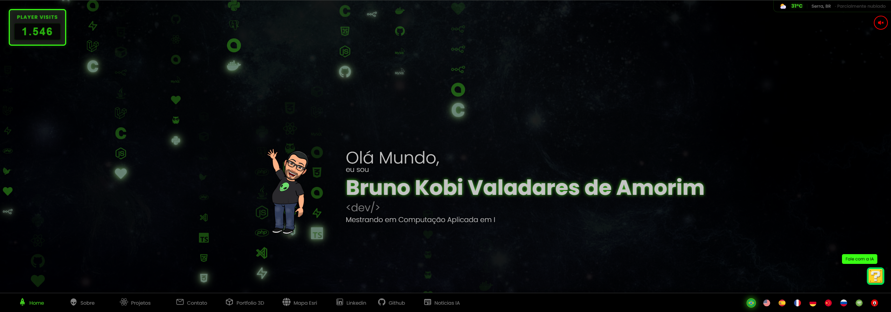

# 🛸 Bruno Kobi — Full Stack Developer & AI Systems Engineer

> **"Não é um portfólio. É um ecossistema digital inteligente em produção."**



<p align="center">
  
  
  
  
  
</p>

<p align="center">
  
  
  
  
  
  
  
  
  
  
  
</p>

<p align="center">
  <a href="https://brunokobi.tech" target="_blank"><strong>🌐 Ver ao vivo</strong></a> ·
  <a href="https://www.linkedin.com/in/brunokobi/" target="_blank">LinkedIn</a> ·
  <a href="https://github.com/brunokobi" target="_blank">GitHub</a>
</p>
<p align="center">
  <sub>(também disponível em <a href="https://brunokobi.netlify.app">brunokobi.netlify.app</a>)</sub>
</p>

<p align="center">
  <a href="https://github.com/sponsors/brunokobi">
    
  </a>
</p>

---

## 🌌 O que é este projeto?

A maioria dos portfólios é uma página estática com foto e lista de habilidades. Este é uma **plataforma de software em produção**:

- **Globo 3D ao vivo** no fundo da Home, com satélites, ISS, terremotos, vulcões, furacões, incêndios, alertas, vento e 69 polos de tecnologia com clima, hora local e qualidade do ar. Todos os dados são reais.
- **JARVIS**, um assistente que ouve e responde por voz, com n8n, Whisper e Piper rodando numa VPS própria.
- **Painel de notícias de IA** com 54 fontes globais, pontuação de relevância e tradução automática.
- **Blog técnico**, página de projetos com status ao vivo da infraestrutura, currículo, mapa 3D e 9 idiomas com detecção pelo IP.

Cada feature foi pensada para mostrar profundidade técnica: não só usar uma tecnologia, mas arquitetá-la, integrá-la e mantê-la no ar.

---

## 🗺️ Páginas

| Rota | O que tem |
|---|---|
| `/` | Apresentação com frases que se digitam sozinhas e o globo 3D ao vivo no fundo |
| `/about` | Sobre, experiência, formação, skills e certificados |
| `/projects` | Projetos com demo e código, e o selo de status ao vivo dos serviços próprios |
| `/curriculo` | Currículo |
| `/news` | Painel de notícias de IA |
| `/blog` e `/blog/<slug>` | Blog dev com posts técnicos sobre os projetos, cada um com endereço próprio |
| `/map` | Mapa 3D ArcGIS com fotos próprias nos marcadores |
| `/chat` | JARVIS em página cheia (ele também abre pelo botão flutuante e pelo menu) |

---

## 🏗️ Arquitetura

```
┌─────────────────────────────────────────────────────────┐
│              Browser (React 18 + Vite 5)                │
│  Globo ArcGIS · WeatherBar · i18n · JARVIS · Notícias   │
└──────────────────┬──────────────────────────────────────┘
                   │ HTTPS
      ┌────────────┼──────────────────┬──────────────────────┐
      ▼            ▼                  ▼                      ▼
Netlify Functions  Supabase       Netlify Fn n8n-chat     Áudio direto do navegador
- news (RSS)       PostgreSQL     (proxy, esconde a URL)  (Whisper e Piper)
- chat (contato)   + RLS                │                      │
  → Resend                              ▼                      ▼
- track → Telegram              Cloudflare (proxy) → Traefik (Coolify)
- infra-stats                            │
                          Oracle Cloud VPS (ARM64, self-hosted)
                          ┌──────────────────────────────────────┐
                          │ n8n: agente JARVIS                    │
                          │ Piper TTS   tts.brunokobi.tech        │
                          │ Whisper     whisper.brunokobi.tech    │
                          │ API do Dataset Grande Vitória         │
                          └──────────────────────────────────────┘

APIs públicas no navegador: Open-Meteo, CelesTrak, wheretheiss.at, USGS,
ArcGIS Living Atlas, Nominatim, ipapi.co, Google Translate
```

---

## 🛠️ Stack

| Camada | Tecnologia | Uso |
|---|---|---|
| Frontend | React 18 + TypeScript strict | SPA com Context API e rotas com lazy loading |
| Build | Vite 5 | Dev server e bundle de produção |
| UI | Chakra UI v2 + Framer Motion | Design system responsivo e animações |
| i18n | React-Intl | 9 idiomas, detecção automática pelo IP |
| GIS | ESRI ArcGIS Maps SDK | Globo 3D e mapa 3D |
| Banco | Supabase (PostgreSQL + RLS) | Contatos e contador de visitas |
| Serverless | Netlify Functions | Proxy RSS, contato, alertas, números da infra, proxy do chat |
| Automação e IA | n8n self-hosted + NVIDIA Nemotron via OpenRouter | Agente do JARVIS |
| Voz | Piper TTS e Whisper (VPS) + Web Speech API | Fala, transcrição e alternativa do navegador |
| E-mail | Resend | Aviso de novo contato |
| Infra | Oracle Cloud VPS + Cloudflare + Traefik | n8n, Piper, Whisper e API do dataset |
| Qualidade | ESLint 9, Prettier, Vitest, Playwright | 195 testes unitários e 5 E2E |
| Observabilidade | OpenTelemetry | Traces das Netlify Functions |
| Deploy | Netlify + GitHub Actions | Deploy a cada push na `main` |

---

## 🚀 Rodando localmente

**Pré-requisitos:** Node.js 18+, npm 9+, uma conta no [Supabase](https://supabase.com) e uma chave do [ESRI ArcGIS](https://developers.arcgis.com). As Netlify Functions rodam com o [Netlify CLI](https://docs.netlify.com/cli/get-started/).

```bash
git clone https://github.com/brunokobi/projeto-portifolio.git
cd projeto-portifolio
npm install
```

Crie um `.env.local` na raiz (o `.env.example` tem a lista completa):

```env
VITE_SUPABASE_URL=https://xxxx.supabase.co
VITE_SUPABASE_ANON_KEY=eyJhbGciOiJIUzI1NiIs...
VITE_ESRI_API_KEY=AAPTxy8BH...
```

As variáveis das Netlify Functions ficam no painel do Netlify:

| Variável | Uso |
|---|---|
| `N8N_WEBHOOK_URL` | Webhook do JARVIS no n8n (obrigatória para o chat) |
| `RESEND_API_KEY`, `CONTACT_TO_EMAIL` | E-mail do formulário de contato |
| `TELEGRAM_BOT_TOKEN`, `TELEGRAM_CHAT_ID` | Alertas no Telegram |
| `OTEL_EXPORTER_OTLP_ENDPOINT`, `OTEL_EXPORTER_OTLP_HEADERS` | Tracing (opcional) |

```bash
npm start            # Dev server na porta 3000
npm run build        # Build de produção em /dist
npm run preview      # Serve o build localmente
npm test             # Testes em modo watch
npm run test:run     # Testes uma vez (CI)
npm run coverage     # Cobertura
npx playwright test  # Testes E2E
netlify dev          # App + Netlify Functions
```

---

## 🌍 Globo 3D ao vivo (Home)

> **Complexidade:** ⭐⭐⭐⭐⭐ — ArcGIS SceneView + canvas sobreposto + 10 fontes de dados públicas + SGP4 no navegador

O fundo da Home é um globo 3D (`src/components/GlobeBackground/`) feito com o **ArcGIS Maps SDK**. Nenhuma camada usa dado simulado: quando uma fonte real não funcionou, a camada saiu do globo.

### Base do globo

- **Dia:** imagem de satélite `World_Imagery` da Esri, com iluminação uniforme no globo inteiro.
- **Noite** (botão `☾ NOITE`): luzes da Terra do **NASA Black Marble** (VIIRS, via NASA GIBS). Um `BaseTileLayer` próprio recolore cada tile pixel a pixel: oceano em preto puro e cidades de âmbar a dourado.
- **Relevo:** `WorldElevation3D` com montanhas exageradas 40× e fundo do mar 60×.
- **Nuvens:** esfera com textura de nuvens da NASA (imagem fixa, não ao vivo).
- **Entrada:** a câmera parte de 65.000 km e desce até ~20.000 km em 4 s; a rotação automática começa depois.

### Camadas em tempo real

Cada camada tem um botão ON/OFF na barra do topo (`WeatherBar`). A escolha fica salva no navegador.

| Camada | Fonte | Atualização | Hover |
|---|---|---|---|
| 🛰️ Satélites | CelesTrak (GPS, Galileo, meteorológicos) + SGP4 (`satellite.js`) | Posição a cada 10 s, TLE em cache de 2 h | Nome e altitude |
| 🛰 ISS | wheretheiss.at | 8 s | Altitude e velocidade |
| 🏙️ Cidades | `CITIES` + Open-Meteo + OpenAQ (Living Atlas) | Clima em cache de 2 h | Hora local, clima, temperatura e qualidade do ar |
| 🔥 Incêndios | NASA VIIRS (Living Atlas): últimas 6 h, confiança alta, FRP ≥ 10 | Ao carregar | Satélite, potência e confiança |
| ⚠️ Alertas | CAP Alerts Feed (Living Atlas) | Ao carregar | Evento, severidade, área e órgão |
| 🌍 Terremotos | USGS, M4.5+ das últimas 24 h | Ao carregar | Magnitude, local e há quanto tempo |
| 🌋 Vulcões | Smithsonian GVP (425 vulcões) | Ao carregar | Nome, país, tipo e altitude |
| 🌀 Furacões | Active Hurricanes (Living Atlas, NHC + JTWC) | Ao carregar | Nome, categoria, vento e pressão |
| 💨 Vento | Grade GFS de 1° (`firestorm-wind-data`) | Ao carregar | 700 partículas coloridas pela velocidade |

Ficaram de fora: aviões (o OpenSky bloqueia CORS), Starlink (o CelesTrak responde 403), nuvens ao vivo (exigem autenticação), correntes marítimas (limite de requisições) e aurora boreal.

### 69 polos de tecnologia

Anéis verdes pulsantes nos maiores polos de tecnologia, escolhidos entre as maiores manchas de luz noturna. O card de hover mostra a descrição, a hora local, o clima e a qualidade do ar da estação mais próxima (até 50 km; sem estação, o card fica sem esse dado).

| Continente | Cidades |
|---|---|
| América do Sul | Vitória-ES, São Paulo, Belo Horizonte, Rio de Janeiro, Campinas, Florianópolis, Recife, Buenos Aires, Santiago, Bogotá |
| América do Norte | San Francisco, Los Angeles, Seattle, Vancouver, Austin, Dallas, Chicago, Atlanta, Miami, Boston, Nova York, Toronto, Montreal, Cidade do México, Guadalajara, Monterrey |
| Europa | Londres, Dublin, Paris, Amsterdã, Berlim, Munique, Zurique, Milão, Madri, Barcelona, Estocolmo, Tallinn, Varsóvia, Istambul |
| África | Lagos, Nairóbi, Cairo, Cidade do Cabo, Joanesburgo |
| Oriente Médio | Tel Aviv, Dubai, Riad |
| Ásia | Tóquio, Osaka, Seul, Pequim, Xangai, Shenzhen, Hong Kong, Taipei, Singapura, Kuala Lumpur, Jacarta, Ho Chi Minh, Bangkok, Manila, Bangalore, Hyderabad, Mumbai, Délhi |
| Oceania | Sydney, Melbourne, Auckland |

Quando dois nomes se encostariam na tela, só aparece o da cidade que vem antes em `CITIES`; o anel das duas continua visível.

### Interação

- **Seu pin:** com a localização liberada, um pin amarelo marca onde você está, com o nome da cidade pelo Nominatim.
- **Arcos de voo:** clicar num pin desenha um arco laranja animado até Vitória-ES pelo grande círculo (interpolação esférica em 81 pontos, pico de 1.200 km). A câmera segue a ponta do arco e a rotação volta quando ele some.
- **Arrastar** pausa a rotação por 3 s. **Clicar** no globo mostra a latitude e a longitude do ponto.
- **Zoom** de 4.000 a 25.000 km. Os ícones diminuem com a câmera longe e as linhas de vento engrossam de perto (`iconScale.ts`).

### Como funciona por dentro

- Um canvas 2D fica por cima do globo e é redesenhado a cada quadro com `requestAnimationFrame`.
- Cada ponto só é desenhado se estiver no lado da Terra virado para a câmera (`isFacing`, produto escalar) e é projetado na tela com `view.toScreen`.
- Cada fonte tem seu próprio arquivo, timeout e devolve lista vazia se falhar: uma API fora do ar apaga só a sua camada.
- O build não renomeia identificadores (`minifyIdentifiers: false`), porque a renomeação quebrava os handlers de hover em produção.

Detalhes de cada camada: [docs/FEATURES.md](docs/FEATURES.md). História completa no post do blog *"O globo do meu portfólio"*.

---

## 🤖 JARVIS — assistente com voz

> **Complexidade:** ⭐⭐⭐⭐⭐ — agente n8n com perfil gerado no build + Whisper + Piper, tudo self-hosted

O visitante pergunta por texto ou por voz: o **Whisper** transcreve, o agente do **n8n** responde e o **Piper** lê a resposta em voz alta. Os três rodam na VPS da Oracle Cloud, atrás da Cloudflare.

### Por que um agente só, com o perfil no prompt

A versão anterior tinha um roteador, 7 agentes especializados e busca vetorial, e inventava experiência porque os agentes nem sempre buscavam os fatos. Hoje o build gera `/jarvis/perfil.md` a partir dos mesmos textos do site (currículo, projetos e skills), e um único agente recebe esse perfil inteiro como **única fonte**. Mudou o site, o JARVIS já sabe no próximo deploy.

### Fluxo

```
Visitante fala
  → useWhisperRecorder grava e para após 1,5 s de silêncio
  → POST whisper.brunokobi.tech/inference (com um prompt de vocabulário: JARVIS, Kobi, Vennx...)
  → POST /.netlify/functions/n8n-chat { chatInput, sessionId }
  → n8n: Chat Trigger → baixa /jarvis/perfil.md → agente (memória de 10 mensagens)
  → resposta curta, escrita para ser ouvida
  → GET tts.brunokobi.tech/tts.mp3, trecho a trecho
  → voz do navegador se o Piper falhar
```

### O que o widget faz

- **Saudação** com bom dia/boa tarde/boa noite, cidade, temperatura e clima (Open-Meteo e Nominatim); sem localização, uma apresentação fixa.
- **Núcleo animado** (`JarvisCore.tsx`) com os estados Online, Pensando, Falando e Ouvindo. Com a voz do Piper, as barras seguem o espectro real da fala (`AnalyserNode`).
- **Conversa por voz:** depois de responder uma pergunta falada, o JARVIS volta a ouvir sozinho; 6 s sem fala fecham o microfone.
- **Pronúncia:** um dicionário faz o Piper dizer "Cóbi", "Vénix" e "Járvis", e links e e-mails são lidos sem soletrar.
- Sugestões de perguntas, indicador de digitando e respostas com negrito, listas e links (sem injetar HTML).
- Abre pelo botão flutuante, pelo item **JARVIS** do menu de baixo e pela rota `/chat`.
- Cada pergunta e resposta chega no Telegram do Bruno (ver [Alertas](#-alertas-no-telegram)).

### Infraestrutura de voz

| Serviço | Como roda | Limites |
|---|---|---|
| Piper TTS | FastAPI + `piper-tts`, vozes masculinas em pt, en, es, fr, de, ru e ar | 1.200 caracteres por pedido, 30 sínteses/min por IP, cache de 30 dias na Cloudflare |
| Whisper | whisper.cpp (modelo base) atrás de um gateway FastAPI | CORS só para o site, timeout de 30 s no cliente |

A mesma voz do Piper lê os textos do site no hover (acessibilidade), com a voz do navegador para o chinês.

---

## 📰 Painel de notícias de IA

> **Complexidade:** ⭐⭐⭐⭐⭐ — proxy RSS serverless + scoring + carrossel + tradução automática + anti-spam

Agrega **54 feeds RSS** de IA (OpenAI, Anthropic, DeepMind, NVIDIA, pesquisa, imprensa e Brasil), pontua por relevância, descarta artigos antigos e spam, traduz para português e destaca as melhores notícias num carrossel.

```
/.netlify/functions/news?url=<feed>   (só hosts da lista de feeds, timeout 8 s, cache 5 min)
  → parseRSS (RSS 2.0, Atom, Media RSS) → cleanDesc
  → heroScore: candidatos ao carrossel são traduzidos primeiro
  → tradução em lotes (até 80 artigos por ciclo, idioma detectado sozinho)
  → scoreArticle · isTooOld (antes de 2025) · isSpam · isRelevant
  → carrossel: últimos 7 dias por heroScore · lista: por importância ou data
```

**heroScore** soma um bônus por fonte (labs primários primeiro), palavras de lançamento e de empresas com teto, e um peso forte de recência (+55 com menos de 2 h). Fontes mistas, como Tecnoblog e SCMP, só entram com palavra-chave de IA ou dev.

**Fontes:** SWEN.AI · AINEWS · Exame IA · TabNews · Manual Usuário · MIT Tech BR · Tecnoblog · Brazil Journal · NeoFeed · Olhar Digital · OpenAI · Anthropic · DeepMind · Google Research · NVIDIA Blog · Apple ML · AWS ML · MIT News · MIT Tech Rev · BAIR · Stanford AI · ETH Zurich · TUM · arXiv AI · The Gradient · IEEE Spectrum · IEEE TV AI · ScienceDaily · Reuters Inst. · The Verge · VentureBeat · Forbes AI · TechCrunch · Wired AI · AI News · AI Insider · AI Weekly · MarkTechPost · HuggingFace · KDnuggets · fast.ai · TensorFlow · Towards AI · LangChain · Synced · AI Singapore · RIKEN AIP · ChinAI · SCMP Tech · Pragmatic Eng. · Martin Fowler · Netflix Tech · n8n Blog · Supabase

---

## ✍️ Blog, projetos e Home

> **Complexidade:** ⭐⭐⭐ — blog em blocos tipados + ping cross-origin por imagem + números via Netlify Function + animação de digitação com pausa no hover

- **Blog dev** (`src/pages/DevBlog/`): posts versionados no código, em blocos (títulos, texto, listas, código e imagens), sobre os projetos: JARVIS, o dataset da Grande Vitória, o jogo Copa Aspirador, o globo e a VPS da Oracle.
- **Projetos:** cards com demo, código e tags, nos 9 idiomas. O JARVIS também lê esses textos.
- **Status ao vivo** (`ServiceStatus`), no topo de `/projects`: confere a cada 60 s se o n8n e o dataset estão no ar, com a latência medida no navegador do visitante. A checagem carrega uma imagem de cada serviço, porque o bloqueio ORB do Chrome dava falso "offline" com `fetch` em `no-cors`. Os números do dataset vêm da function `infra-stats` (a API não libera CORS), com cache de 5 min; se falhar, o bloco some.
- **Home:** 10 frases se alternam como numa máquina de escrever: cada uma fica 3,8 s inteira, há um intervalo de 0,6 s entre elas, o cursor pisca e a frase não é apagada com o mouse em cima.

---

## 🔎 SEO e prévias de link

> **Complexidade:** ⭐⭐⭐⭐ — HTML por rota gerado no build + dados estruturados + sitemap automático + IndexNow no deploy

O site é uma SPA, mas cada rota e cada post do blog tem um HTML próprio gerado no build (`seoPages` em `vite.config.ts`, lógica em `src/seo/seoPages.ts`), servido pelo `_redirects`:

- **Título, descrição e endereço oficial** (`canonical`) por página, sempre em `brunokobi.tech`. O `brunokobi.netlify.app` redireciona com 301.
- **Prévia de link** (Open Graph e Twitter Card) com imagem de 1200×630 por post (`public/og/`), para LinkedIn, WhatsApp e X.
- **Dados estruturados** (schema.org): `Person` e `WebSite` na Home, `Blog` na lista e `BlogPosting` em cada post.
- **O texto da página já no HTML**, para buscadores que não rodam JavaScript; o React substitui esse conteúdo ao carregar.
- **Sitemap gerado no build** com todas as rotas e posts (`/sitemap.xml`), e o título da aba muda a cada navegação (`src/seo/routeMeta.ts`).
- **IndexNow:** depois de cada deploy de produção, a function `deploy-succeeded` avisa Bing, Yandex e outros buscadores de todas as URLs do sitemap.

Cada post tem endereço próprio (`/blog/<slug>`), compartilhável e indexável.

---

## ⚡ Formulário de contato

> **Complexidade:** ⭐⭐⭐⭐ — gravação no Supabase + Netlify Function → Resend

```
Formulário
  → 1. INSERT no Supabase (tabela contatos, RLS): a mensagem nunca se perde
  → 2. POST /.netlify/functions/chat → Resend envia o aviso por e-mail (campos escapados no HTML)
  → toast: "SINAL RECEBIDO" (tudo certo) · "SINAL PARCIAL" (gravou, e-mail falhou) · "FALHA NA TRANSMISSÃO"
```

---

## 🌐 Idiomas

> **Complexidade:** ⭐⭐⭐ — geolocalização por IP + mapeamento país → idioma + troca por Context API sem reload

Na primeira visita, o site aparece no idioma do país do visitante (ipapi.co). A troca é feita por React Context, sem recarregar a página. São 9 idiomas: português, inglês, espanhol, francês, alemão, chinês, russo, árabe e klingon 🖖.

---

## 📊 Contador de visitas

> **Complexidade:** ⭐⭐⭐ — RPC atômica no Supabase + visual estilo Matrix em CSS

Contador no PostgreSQL com incremento por **RPC atômica**, sem corrida entre visitantes simultâneos. Visual de placa estilo Matrix, com dígitos verdes, scanlines e flicker em CSS.

```sql
create or replace function increment_views()
returns bigint language sql as $$
  update page_views set count = count + 1 where id = 1
  returning count;
$$;
```

---

## 📲 Alertas no Telegram

> **Complexidade:** ⭐⭐⭐ — Netlify Functions + Telegram Bot API + geolocalização pelo header da Netlify + limite por conversa

A function `track.ts` avisa no Telegram, sem expor o token no navegador, quando alguém visita uma página, abre ou envia o contato, abre o chat, o mapa ou as notícias, clica num link externo ou no item do JARVIS no menu.

As conversas do JARVIS também chegam, enviadas por `n8n-chat.ts` (`netlify/lib/chatAlert.ts`):

```
🤖 JARVIS: nova conversa
🌍 Serra, ES — BR
🆔 1a2b3c4d

👤 Visitante: Quem é o Bruno?

💬 JARVIS: O Bruno é desenvolvedor full stack...
```

- Local pelo header de geolocalização da Netlify, sem pedir permissão ao visitante.
- Texto puro, limite de 30 avisos por conversa por hora, corte em 1.500 caracteres e timeout de 3 s.
- Se o n8n falhar, chega "⚠️ JARVIS falhou"; se o Telegram falhar, o chat segue normal.

---

## 🔭 Observabilidade

> **Complexidade:** ⭐⭐⭐ — tracing distribuído nas Netlify Functions via OTLP/HTTP

As Netlify Functions geram traces com **OpenTelemetry** (OTLP/HTTP) para qualquer backend compatível, como Grafana Cloud, Honeycomb ou New Relic. Sem `OTEL_EXPORTER_OTLP_ENDPOINT`, o tracing fica desligado.

| Function | Span | Spans filhos |
|---|---|---|
| `track.ts` | `track.handle` | `telegram.sendMessage` |
| `chat.ts` | `chat.contact` | `resend.sendEmail` |
| `news.ts` | `news.proxy` | — |

Usa `SimpleSpanProcessor` com `forceFlush()` antes de cada resposta: em serverless o processo pode encerrar logo depois do `return`, e o processador em lote perderia spans.

---

## 🧪 Testes e CI

> **Complexidade:** ⭐⭐⭐⭐ — 195 testes Vitest + Playwright E2E + GitHub Actions + Lighthouse CI

**195 testes unitários** (Vitest) em 34 arquivos, cobrindo, entre outros:

- **Globo:** satélites, ISS, terremotos, vulcões, furacões, vento, tamanho dos ícones e nomes de cidades que não se sobrepõem.
- **JARVIS:** widget (microfone e conversa por voz), Piper, Whisper, perfil gerado no build, formatação das respostas e alerta no Telegram.
- **Notícias:** parser RSS, scoring, spam e relevância.
- **Interface:** WeatherBar, ServiceStatus, contato, menu, frases da Home, datas do blog, ErrorBoundary e idiomas.
- **SEO:** HTML por rota, prévias, sitemap, redirecionamentos e IndexNow.

**5 testes E2E** (Playwright, Chromium): a Home carrega sem erros, o menu aparece, `/about` e `/projects` renderizam e uma rota inexistente não quebra o app.

**GitHub Actions** a cada push ou PR na `main`:

| Workflow | Passos |
|---|---|
| `ci.yml` | `tsc --noEmit`, lint, testes e build |
| `e2e.yml` | Build e Playwright |
| `lighthouse.yml` | Lighthouse CI (performance, acessibilidade e SEO) |

---

## 🔐 Segurança

> **Complexidade:** ⭐⭐⭐ — RLS no banco + segredos só no servidor + allowlist no proxy + CORS restrito + HTML escapado

| Camada | Mecanismo |
|---|---|
| Banco | Row Level Security no Supabase |
| Segredos | Tokens só nas Netlify Functions; o navegador recebe só chaves públicas (`VITE_*`) |
| Proxy RSS | Aceita só HTTPS dos hosts da lista de feeds; não é um proxy aberto |
| Chat | O proxy esconde a URL do n8n |
| Whisper | CORS liberado só para o site |
| Contato | Nome, e-mail e mensagem escapados antes de virar HTML |
| Erros | ErrorBoundary global com tela de recuperação |

---

## 📱 Acessibilidade e mobile

> **Complexidade:** ⭐⭐⭐ — voz neural Piper self-hosted + ARIA + breakpoints do Chakra UI por componente

- Hover em textos lê o conteúdo em voz alta no idioma escolhido, com a voz do Piper.
- Atributos ARIA nos elementos interativos (`aria-label`, `aria-pressed`, `aria-live` no carrossel).
- Layouts adaptados no celular: carrossel de notícias, categorias com rolagem horizontal, cards de projetos, modal de contato em tela cheia e menu com rolagem horizontal.

---

## 📚 Documentação técnica

A pasta [`docs/`](docs/INDEX.md) detalha arquitetura, componentes, cada feature, APIs, stack e setup. Comece por [docs/AI_QUICKSTART.md](docs/AI_QUICKSTART.md).

---

## 🛸 Sobre Bruno Kobi

Full Stack Developer & AI Systems Engineer especializado em transformar complexidade técnica em produtos que funcionam em produção.

🔗 [brunokobi.tech](https://brunokobi.tech) · [LinkedIn](https://www.linkedin.com/in/brunokobi/) · [GitHub](https://github.com/brunokobi)

---

## 💛 Apoie o projeto

[](https://github.com/sponsors/brunokobi)

Este portfólio é código aberto e mantido nas horas vagas, com infraestrutura própria (VPS na Oracle Cloud com n8n, Piper e Whisper). Se ele te inspirou ou ajudou, considere apoiar: ajuda a manter tudo no ar.

### ⭐ Se este projeto te inspirou, deixe uma estrela. Leva 1 segundo e ajuda demais!
